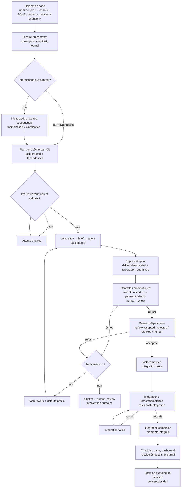

# Production de l'open world — workflow, checklist et carte de chantier

Document de référence du suivi de production des 20 zones de *L’Archipel des Souvenirs* (les 19 de la
demande initiale et Les Cascades Sacrées, ajoutée le 25/10/2026). Il décrit
l'architecture, les rôles, les contrats, le modèle de données, les règles de calcul et les
procédures. L'état courant (ce qui est livré, ce qui reste) est dans `LIVRAISONS.md`.

## En bref

- **Source de vérité unique** : le journal `production/journal.jsonl` (événements en ajout seul,
  chaînés par SHA-256). Les statuts des tâches, livrables, validations, intégrations et éléments de
  checklist en sont **rejoués** ; rien n'est recopié à la main ailleurs.
- **Définitions statiques** : `production/zones.json` (20 zones), `production/agents.json` (quatre
  rôles et relecteurs), modèle du checklist dans `src/production/checklist.js`.
- **Vues dérivées** : la carte de chantier et les centres du dashboard (`/dashboard.html#chantier`),
  la commande `npm run prod -- etat`.
- **Boucle** : objectif → plan de tâches (orchestrateur) → agent → rapport → contrôles automatiques →
  revue indépendante → tâche terminée → intégration et tests post-intégration → checklist et carte à
  jour, sans ressaisie.



## Les quatre rôles et l'orchestrateur

Les rôles du workflow sont associés aux agents qui existent déjà dans `.claude/agents/`
(`production/agents.json`) ; seul le Technical Artist, sans équivalent, a été ajouté.

| Rôle | Agent | Sections du checklist | Livrable type | Relecteur | Chemins autorisés |
| --- | --- | --- | --- | --- | --- |
| World Designer | `archipel-calibrateur` | B, F | `production/fiches/<ZONE>.json` | `archipel-critique` | `production/fiches/`, `src/world/archipel.js`, `src/world/islands/`, `tests/` |
| Asset Artist | `evis` | D | `production/assets/<ZONE>.json` (et modèles selon la skill modele-3d) | `evis-critique` | `production/assets/`, `src/models/`, `tests/fixtures/empreintes.json` |
| Gameplay Agent | `locomotion-physique` | C | `tests/zones/<zone>.test.js` | `archipel-critique` | `tests/`, `src/gameplay/`, `src/entities/`, `src/world/navigation.js`, `src/data/` |
| Technical Artist | `archipel-integrateur` (nouveau) | E, G | `production/integration/<ZONE>.json` | `archipel-critique` | `production/integration/`, `tests/` |

Un humain peut relire tous les rôles. La section H (décision de livraison) est humaine.

**Orchestrateur** : couche déterministe, sans LLM, `src/production/orchestrateur.js`, exposée par
`npm run prod` et par le dashboard. Il crée l'objectif et les tâches, suspend ce qui attend une
clarification, prépare (`task.ready`) une tâche seulement quand tous ses prérequis sont terminés **et**
validés, clôt une tâche contrôlée et acceptée en revue. Lancer un agent reste le geste du coordinateur
de session (outil Agent de Claude Code) avec le brief `npm run prod -- brief TASK-…` ; l'hôte n'offre
pas d'exécution autonome des agents et le projet n'appelle aucune API de LLM.

## Contrats

### Tâche (`src/production/contrats.js`, `verifierTache`)

`task_id` (`TASK-<ZONE>-001`), `objective_id`, `zone_id`, `title`, `description`, `assigned_agent`
(un seul rôle), `priority` (P1 à P4), `status` (production), `validation_status`,
`integration_status`, `dependencies` (tâches existantes), `input_references`,
`expected_deliverables` (`[{ path, nature: fichier | specification | test | rapport }]`),
`acceptance_criteria` (non vides, fixés à la création), `validation_method`
(`{ controles: [...], tests?: [...], revue }`), `checklist_items` (éléments de la même zone),
`retry_count`, `created_at`, `updated_at`.

### Rapport d'exécution (`verifierRapport`)

```json
{
  "task_id": "TASK-ILE-VERTE-001", "agent": "world-designer", "etat_final": "termine | bloque | partiel",
  "resume": "…", "fichiers": [{ "path": "…", "action": "cree | modifie", "nature": "…" }],
  "livrables_attendus": ["…"], "livrables_fournis": ["…"],
  "tests": [{ "commande": "npx vitest run …", "resultat": "reussi | echoue | non_execute", "detail": "…" }],
  "erreurs": [], "hypotheses": [], "decisions": [], "checklist": ["ZONE-….B06"],
  "dependances_restantes": [], "prochaine_etape": "…"
}
```

Refusé si : agent différent de l'agent affecté, livrable attendu non fourni pour un rapport
« termine », chemin hors du périmètre du rôle, élément de checklist hors de la tâche, livrable annoncé
absent du disque. Un rapport « bloque » met la tâche en `blocked` avec ses dépendances restantes.

On distingue : **fichier généré** (`deliverable.created`, avec SHA-256), **fichier valide**
(`validation.passed`, empreinte validée), **fichier intégré** (`integration.completed`, même
empreinte), **fonctionnalité testée** (contrôle `tests` réussi), **fonctionnalité jouable** (statut de
zone `jouable`).

### Livrables de zone

- **Fiche de zone** (`verifierFiche`) : `zone_id`, `perimetre { regions, centre { x, z }, rayon }`,
  `relief`, `biomes` (clés de `biomes.js`), `chemins { principaux, secondaires }`, `acces`, `sorties`,
  `reperes`, `points_interet` (lieux `{ nom, type?, position?, fonction?, statut, source? }`),
  `connexions [{ zone, moyen, statut }]`, `zones_cachees`, `verticalite`, `obstacles`,
  `espaces_vides [{ description, statut }]`, `narration { fonction, … }`, `ambiance { visuelle, eclairage, … }`.
  Chaque information est `atteste` (avec `source`, un chemin du dépôt qui existe) ou `proposition`.
- **Inventaire des assets** (`verifierInventaire`) : `existants [{ id, usage, source }]` (identifiants
  du registre), `manquants [{ id_propose, categorie, description, criteres_da, statut: "specification" }]`.
  Un manque n'est `produit` qu'avec un `chemin` qui existe.
- **Rapport d'intégration** (`verifierRapportIntegration`) : `zone_id`, `commit`,
  `controles [{ nom, commande, resultat, detail }]`, `problemes`.

## Modèle de données

| Entité | Où | Identifiant |
| --- | --- | --- |
| Zone | `production/zones.json` | `ZONE-…` (stable, indépendant du nom) |
| Élément de checklist | `src/production/checklist.js` × zones | `ZONE-….B06` |
| Agent / rôle | `production/agents.json` | `world-designer`, … |
| Asset | registre `src/models/registry.js` (catalogue) | `ARB-001`, … |
| Objectif | journal (`objective.created`) | `OBJ-0001` |
| Tâche | journal (`task.created`) | `TASK-ILE-VERTE-001` |
| Livrable | journal (`deliverable.created`) | `DLV-…` |
| Validation | journal (`validation.*`) | `VAL-…` |
| Intégration | journal (`integration.*`) | `INT-…` |
| Événement | `production/journal.jsonl` | `EVT-000001` |

Relations : une zone a 57 éléments de checklist ; une zone renvoie à une ou plusieurs zones du monde
ouvert (`jeu.zones`, identifiants des `ZONES` d’`archipel.js`, plus `home` pour Ton île), d’où viennent
son aire, ses îles et son biome (jamais recopiés) ; un asset est relié à une zone par les espèces que la
génération y place (arbres et décor de la zone, sinon du biome), via la référence `kind:` du registre ; une tâche porte sur une zone et plusieurs éléments,
dépend d'autres tâches, a un seul agent ; un rapport produit des livrables ; un livrable a plusieurs
validations ; une intégration a une version (`git rev-parse`) et des preuves.

**Journal** : une ligne JSON par événement, `{ seq, id, type, at, acteur, cle, donnees, prev, hash }`.
`hash = SHA-256(prev + contenu)` : une ligne modifiée, supprimée ou insérée est détectée
(`npm run prod -- verifier`) et toute écriture est alors refusée. `cle` rend chaque commande
idempotente (rejouer la même commande n'écrit rien). Un lot d'événements est vérifié en entier avant
d'être écrit (atomique) ; un verrou de fichier sérialise CLI et serveur. Versionnement : le journal est
suivi par git (sauvegarde et historique) ; les événements ne sont jamais réécrits — une correction est
un nouvel événement.

Types d'événements : `objective.created`, `task.created`, `task.ready`, `task.started`,
`task.blocked`, `task.unblocked`, `task.report_submitted`, `deliverable.created`,
`deliverable.replacement_approved`, `validation.started`, `validation.passed`, `validation.failed`,
`validation.human_review`, `review.accepted`, `review.rejected`, `review.blocked`, `review.human`,
`task.completed`, `task.reopened`, `task.criteria_changed`, `integration.started`,
`integration.completed`, `integration.failed`, `checklist.item.updated`, `delivery.decided`. Le
statut de zone n'est pas un événement : il est calculé (pas de doublon possible).

## Statuts et transitions (`src/production/statuts.js`)

Trois axes séparés, jamais fusionnés :

- **Production** : `backlog` → `ready` → `in_progress` → `review` → `completed` ; `blocked` et `rework`
  en dérivation ; `completed` → `rework` seulement par `task.reopened` (humain).
- **Validation** : `not_checked` → `running` → `passed` | `failed` | `human_review`.
- **Intégration** : `not_integrated` → `integration_ready` (à la clôture de la tâche) → `integrating`
  → `integrated` | `integration_failed`.

Règles appliquées par `src/production/etat.js` (un événement qui les viole est refusé) :

- seuls les contrôles concluent une validation (un humain peut trancher une `human_review`) ; une
  validation « réussie » exige que tous les contrôles soient `reussi` — un `non_execute` mène à
  `human_review` ;
- la revue est faite par un relecteur déclaré pour ce rôle, jamais par l'agent producteur ; un refus
  cite les critères échoués et la correction attendue ;
- échec de contrôle ou refus de revue : `rework`, `retry_count + 1`, défauts conservés ; à 3
  tentatives : `blocked` + `human_review` + intervention humaine (seul un humain débloque) ;
- un livrable accepté en revue (tâche terminée) ne peut être remplacé qu’après
  `deliverable.replacement_approved` (humain) ; un livrable refusé en revue se corrige librement, chaque
  version restant dans l’historique ;
- l'intégration exige une tâche terminée et validée, des tests post-intégration tous réussis et un
  fichier identique (SHA-256) à celui validé ;
- critères d'acceptation et périmètre d'une tâche ne changent que par décision humaine
  (`task.criteria_changed`, périmètre seulement réduit : `npm run prod -- perimetre`) ;
- un constat d'audit (`acteur: audit`) cite une preuve, ne touche qu'un élément vierge et ne vaut
  jamais validation.

## Checklist (`src/production/checklist.js`)

57 éléments par zone, mêmes clés pour toutes les zones (identité et pilotage, section A, sont portés
par la fiche de zone elle-même) : **B** world design (13), **C** gameplay (11), **D** assets (10), **E**
intégration technique (7), **F** narration et ambiance (6), **G** QA (9), **H** livraison (1). Chaque
élément : identifiant, titre, description, catégorie, priorité, responsable, obligatoire ou optionnel,
`jouable` (requis pour jouer), `critique` (bloque la livraison), critère d'acceptation, méthode de
vérification, preuve attendue ; son état (spécification, production, validation, intégration, tâches,
preuves, date) vient du journal. Un élément non documenté est « à spécifier », pas « manquant » :
seul un élément obligatoire non produit compte comme manque. Une zone peut déclarer des éléments
`non_applicable` (un obligatoire seulement par décision humaine).

## Calcul de la complétude (`src/production/completude.js`)

- **Conception** = éléments applicables spécifiés / éléments applicables.
- **Production** = éléments obligatoires au travail terminé / éléments obligatoires applicables (hors H01).
- **Préparation jouable** = éléments obligatoires `jouable` validés **et** intégrés / obligatoires `jouable`.

Pourquoi ces règles plutôt que des pondérations : les optionnels sont comptés à part (« 0/18 ») et
n'entrent jamais dans les scores, ce qui évite de choisir un poids arbitraire ; les non applicables
sortent du dénominateur ; il n'y a pas de crédit partiel (un élément en cours, bloqué ou non vérifié
vaut 0) ; produire et intégrer sont mesurés séparément. Un élément `critique` non validé et intégré rend
la zone **non livrable** quel que soit son score (une zone à 95 % avec une sortie inaccessible reste
signalée). La décision de livraison H01 ne compte que pour « livrable ».

Statut calculé de la zone, dans cet ordre :

| Statut | Règle | Couleur | Motif / icône |
| --- | --- | --- | --- |
| Bloquée | une tâche bloquée, une intégration échouée ou un élément obligatoire bloqué | rouge foncé `#7d1f24` | hachures, ⛔ |
| Non commencée | aucune tâche, aucun élément entamé ni spécifié | gris `#8e979f` | pointillé, ○ |
| En construction | au moins un manque obligatoire **sans tâche** | rouge `#d2343b` | plein, ▲ |
| Partielle | tous les manques obligatoires ont une tâche active | orange `#e58a2e` | tirets, ◐ |
| En validation | tout est produit, au moins un obligatoire non validé | violet `#7f58c4` | points, ◇ |
| Validée | tout est validé, un élément jouable non intégré | vert clair `#5fae7f` | contour, ✓ |
| Intégrée et jouable | tout est validé et intégré | vert `#1f8a5b` | plein, ★ |

## Carte de chantier (dashboard)

`/dashboard.html#chantier`, module `dashboard/chantier.js`, servi par le dashboard existant.

- **Monde du jeu** (vue par défaut) : le monde ouvert de 6 × 4 km (GEN_VERSION 4), silhouettes calculées
  par le générateur du jeu (`islandgen.js`, comme la carte M ; `home/terrain.js` ; îles du ciel), et par-dessus
  les aires (ellipses) des zones du jeu de chaque zone du checklist. La carte n’invente donc pas une
  synchronisation : ce qu’elle montre du monde vient du code du jeu. Une zone du jeu sans zone du
  checklist serait signalée sous la carte (aucune aujourd’hui).
- **Carte de référence** : la carte de l’utilisateur dont le monde a été tracé (`dashboard/reference/`),
  posée dans le même repère (4 m par pixel, `PX` et `ORIGINE` d’`archipel.js`), avec les mêmes aires.
- Statut calculé, motif, icône et libellé par zone (accessibles au clavier, `aria-label`) ; légende
  cliquable (filtre par statut) ; filtres priorité, agent, catégorie manquante, « manques seulement » ;
  recherche d'une zone ou d'un asset (identifiant ou nom du registre) ; connexions entre zones ; flèches
  de dépendances de la zone choisie.
- **Fiche de zone** : résumé, statut, livrable ou non, trois scores, obligatoires faits/manquants,
  optionnels, prochain jalon, zones en aval, décision de livraison ; onglets checklist (quatre statuts
  par élément, preuves), manques (pourquoi, responsable, tâche), tâches (contrôles, critères,
  livrables), assets (disponibles et intégrés, attendus), tests et QA, dépendances, historique.
- **Actions réelles** (serveur de dev seulement, `POST /__production`) : lancer un chantier, créer une
  tâche ciblée, démarrer, relancer la validation, accepter ou refuser en revue (humain), intégrer,
  débloquer (humain), afficher le brief. Sans serveur (build), la page affiche l'instantané compilé du
  journal en lecture seule, sans boutons d'action.
- **Centres** : progression (par zone, catégorie, agent, dépendances critiques, historique), production
  (colonnes par statut de production), validation, agents (charge, dernier rapport, erreurs ;
  temps et coût non mesurés), assets (registre et zones liées).
- La page relit le journal toutes les 5 s en dev : un rapport rendu en ligne de commande par un agent
  apparaît sans rechargement.

## Lancer le système

```bash
npm run dev            # jeu sur :5173, dashboard sur /dashboard.html#chantier
npm run prod -- etat   # bilan des 19 zones en terminal
npm run prod -- verifier
npm test               # dont tests/production-*.test.js
```

Les agents utilisent la configuration `ile` (port 5174) pour ne pas gêner la partie de l'utilisateur.

## Procédures

**Lancer un chantier** : `npm run prod -- chantier ZONE-…` (ou bouton). Puis, pour chaque tâche prête :
`npm run prod -- demarrer TASK-… --acteur <rôle>`, `npm run prod -- brief TASK-…`, lancer l'agent du
rôle avec ce brief ; l'agent écrit son livrable et son rapport puis
`npm run prod -- rapport production/rapports/TASK-….json` (contrôles automatiques). Revue :
`npm run prod -- revue TASK-… --acteur <relecteur> --decision accepte|refuse …` (le verdict est celui
du relecteur, consigné tel quel). Intégration : `npm run prod -- integrer TASK-…`.

**Ajouter une zone** : ajouter une entrée à `production/zones.json` (identifiant `ZONE-…` jamais
réattribué, `ordre`, `jeu.zones` avec les identifiants des zones du jeu et `jeu.correspondance`,
connexions et dépendances existantes), puis `npm test` (tests de données) ; le checklist de la zone est créé par le modèle.

**Ajouter un asset** : le créer selon la skill `modele-3d` (identifiant du registre), puis le citer par
son identifiant dans l'inventaire de la zone (`production/assets/<ZONE>.json`) ; jamais de copie de la
fiche du modèle.

**Valider et intégrer** : contrôles automatiques au rapport ; `npm run prod -- valider TASK-…` pour
relancer ; une `human_review` se tranche par une revue humaine ; intégration seulement après
`completed` + `passed`.

**Constats d'audit** : `npm run prod -- audit` (idempotent) inscrit, avec preuve, ce qui existe déjà
dans le monde ouvert pour chaque zone (9 éléments : aire, relief, biome, terrain, arbres, palette,
chargement, collisions, sauvegarde ; 171 constats), sans jamais valoir validation. L’étape « bases » du
monde ouvert n’a ni lieux, ni chemins, ni villages, ni faune, ni ressources : aucun constat là-dessus.

## Tests

- `tests/production-donnees.test.js` : 19 zones et noms, identifiants uniques, références, lien
  aux zones du monde ouvert (chacune une seule fois, les zones du jeu non suivies déclarées), checklist, rôles et fichiers d'agents, journal versionné
  intègre et preuves d'audit existantes.
- `tests/production-workflow.test.js` : chantier et dépendances, clarification, rapport et contrôles
  réels, revue indépendante, périmètre, tentatives limitées, critères et périmètre humains, livrable
  validé protégé, intégration distincte et empreinte, audit, idempotence, atomicité, chaîne du journal,
  validation interrompue, vues identiques après redémarrage.
- `tests/production-carte.test.js` : rendu réel de la carte (19 zones, rouge, bloquée sans couleur,
  validée, jouable), fiche, manques, filtres, mise à jour, événements refusés signalés.

## Limites connues et décisions

- Pas de PDF de checklist : par décision de l’utilisateur (25/10/2026), la référence est la structure A
  à H de la demande initiale ; les descriptions des zones viennent de la carte de référence.
- Le monde ouvert (GEN_VERSION 4) a 24 zones nommées ; les 19 zones du checklist y renvoient toutes
  (correspondance « nom » quand le jeu porte le même nom, sinon « proposition » à confirmer) ;
  `cascades-sacrees` n’a pas de zone du checklist. Une zone sans zone du jeu verrait ses tâches de
  gameplay et d’intégration suspendues (clarification).
- Le relevé d’usage des modèles (`USAGE` de `releves.gen.js`) date encore des neuf îles d’avant le monde
  ouvert : `npm run modeles:releve` est à relancer ; la carte relie donc les assets par les espèces de
  chaque zone, pas par ce relevé.
- Les agents ne s'exécutent pas d'eux-mêmes : le coordinateur les lance avec le brief. Le temps et le
  coût des agents ne sont pas mesurés (l'hôte ne les expose pas au dépôt).
- Le contrôle `suite` compare aux échecs connus de `production/echecs-connus.json` ; `build` lance
  `vite build` dans un dossier temporaire.
- Pas de base de données ni de service : un fichier JSONL versionné suffit au volume (quelques
  milliers d'événements) et garde l'historique dans git.
